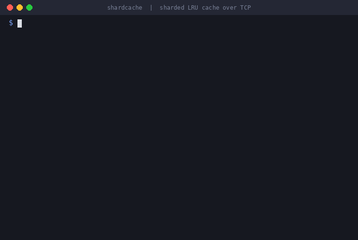
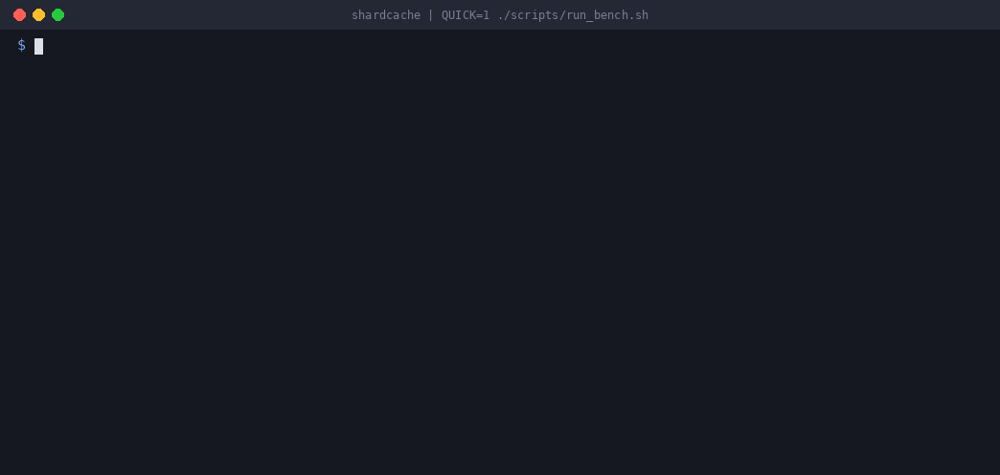
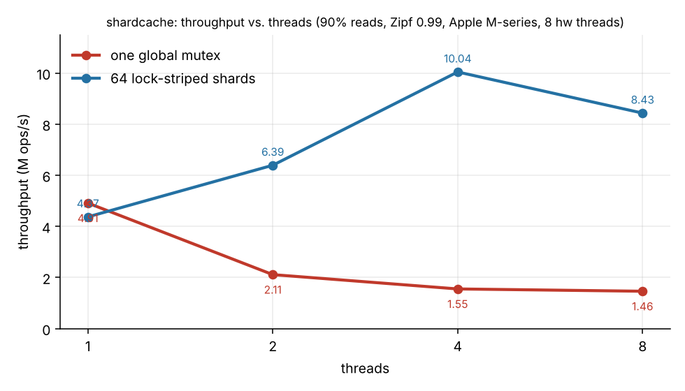

# shardcache

A concurrent in-memory key-value cache server in C++20: lock-striped LRU shards
behind a small TCP text protocol, with a benchmark harness that measures how
throughput and tail latency scale with threads.


<p align="center">
  
</p>

*A real session against the running server (the same commands as in [Run](#run)).*

## Why

A single LRU cache behind one mutex serializes every request, including reads,
because a read updates recency order. Splitting the keyspace across N
independently locked shards lets operations on different shards run in
parallel. The cost is that eviction becomes LRU per shard rather than globally.
This project measures that trade-off instead of assuming it.

## Layout

```
include/shardcache/
  cache.h          thread-safe Cache interface (server + bench use only this)
  lru_cache.h      single-threaded O(1) LRU
  locked_cache.h   baseline: one LRU, one global mutex
  sharded_cache.h  N LRU shards, one mutex each
  protocol.h       line protocol parser/executor
  server.h         TCP server (acceptor + thread per connection, pipelining)
  client.h         blocking client
bench/             in-process benchmark (Zipf workload) + network load generator
tests/             GoogleTest: model-based LRU test, concurrency stress, protocol, server
```

## Build and test

```bash
cmake -S . -B build -G Ninja && cmake --build build
./build/shardcache-tests

# data-race check
cmake -S . -B build-tsan -G Ninja -DSHARDCACHE_TSAN=ON && cmake --build build-tsan && ./build-tsan/shardcache-tests
```

## Run

```bash
./build/shardcache-server --port 7070 --impl sharded --shards 64 --capacity 100000
```

```
$ nc localhost 7070
SET user:1 Umer
OK
GET user:1
VALUE Umer
STATS
STATS size=1 capacity=100000
```

| Request | Response |
|---|---|
| `PING` | `PONG` |
| `GET <key>` | `VALUE <value>` or `NOT_FOUND` |
| `SET <key> <value>` | `OK` (value is the rest of the line) |
| `DEL <key>` | `DELETED` or `NOT_FOUND` |
| `STATS` | `STATS size=<n> capacity=<n>` |

Keys are 1 to 250 bytes with no whitespace. Requests can be pipelined; responses come back in order.

## Benchmarks

```bash
./scripts/run_bench.sh
```

<p align="center">
  
</p>

*A quick run (`QUICK=1`) on an 8-thread Mac. Sharding pays off in the in-process table. Over loopback TCP the two come out close.*

Workload: 1M keys, 500k capacity, 90% reads, Zipf(0.99) key popularity, 64-byte
values, median of 3 runs. Results: [bench/results/RESULTS.md](bench/results/RESULTS.md).



At 8 threads the sharded cache does 8.43M ops/s against 1.46M for the single-mutex baseline (5.8x), with p99 latency of 18.6 us against 88.4 us. Numbers are from an 8-thread Apple Silicon Mac; the full table, including network results, is in the results file.


## Design notes

See [docs/DESIGN.md](docs/DESIGN.md).
